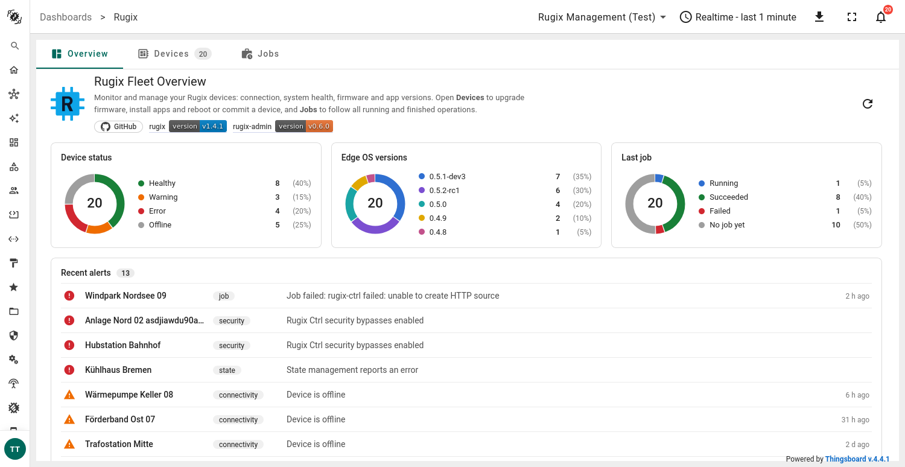
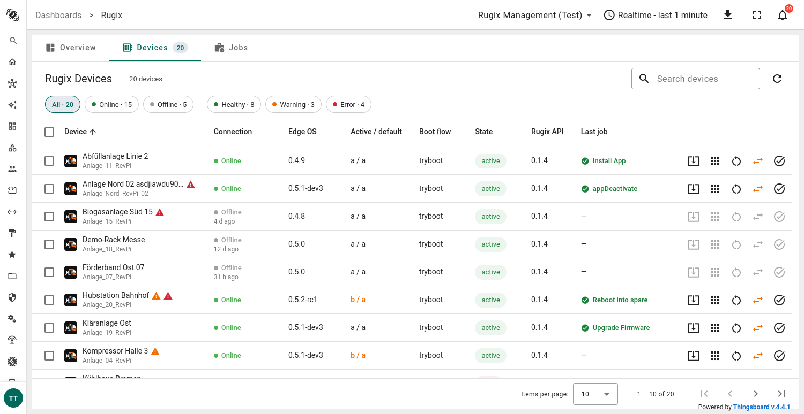
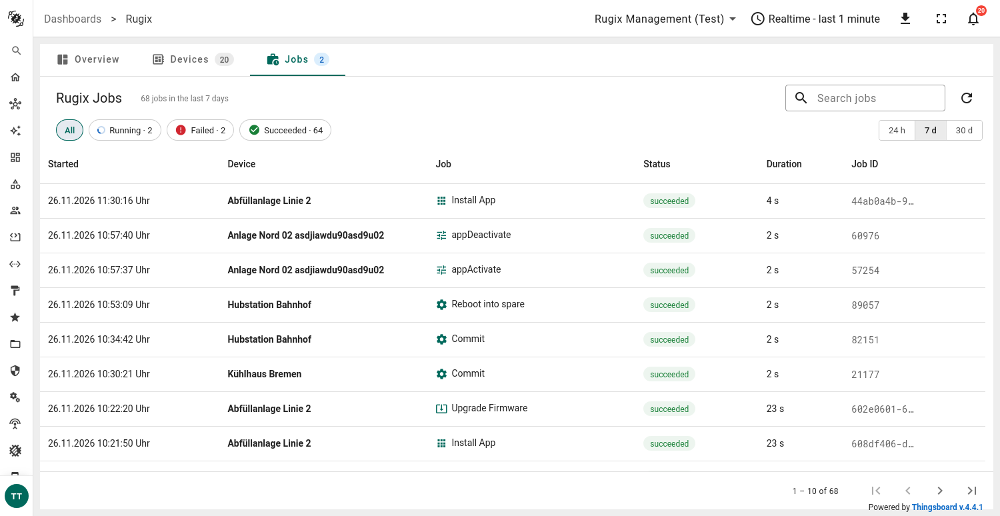
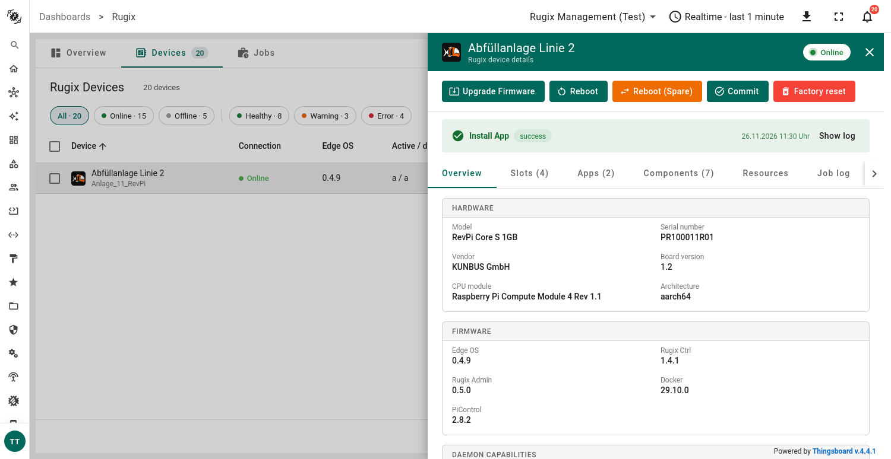
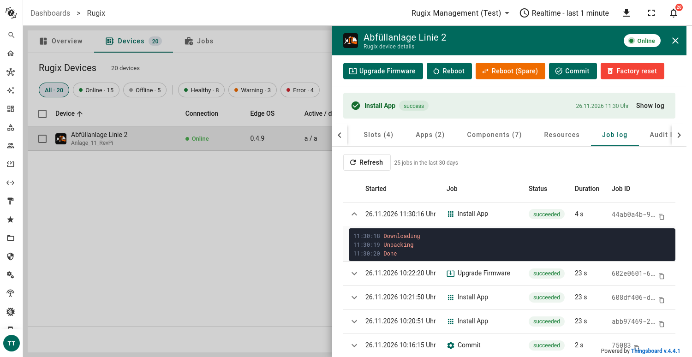
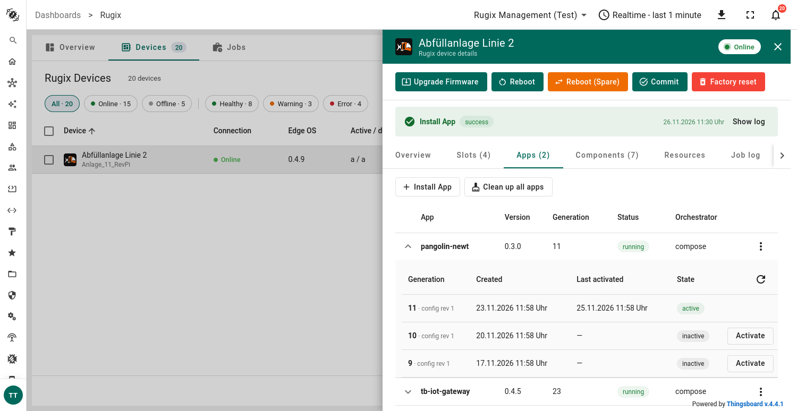
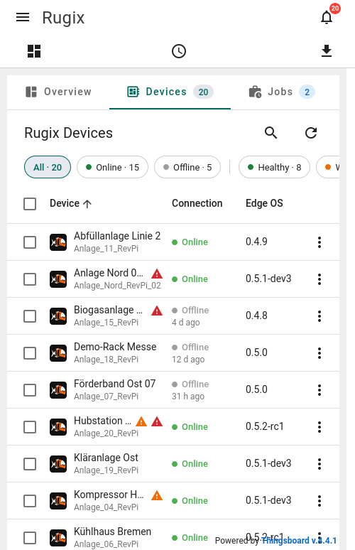
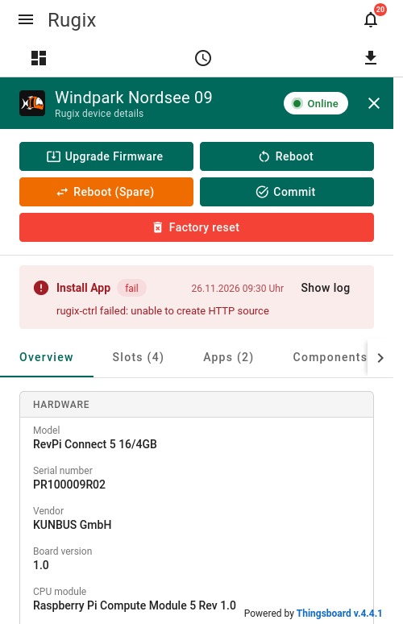

# Rugix management extension

Widget `tb-rugix-agents` – manage [Rugix](https://github.com/rugix) devices from ThingsBoard, modelled after
**Edge management → Agents** of ThingsBoard 4.4 (entity table, details panel with tabs, action dialogs with job progress).

```
widget ──RPC──▶ ThingsBoard ──▶ TB IoT Gateway (request connector) ──▶ Rugix Admin REST API
   ▲                                   │
   └──── attributes / telemetry ◀──────┘   (poll mappings + SSE stream of /api/jobs/{id}/events → `jobEvent`)
```

## Features
Six views in the top menu:

| View | What it shows |
|------|---------------|
| **Overview** | Fleet donuts (device status, Edge OS versions, firmware vs. release channel, last job), recent alerts (offline, commit pending, failed jobs, state errors, security bypasses), Rugix logo, GitHub link and version badges |
| **Devices** | Sortable / searchable / paginated table (connection incl. online/offline since, Edge OS, active / default boot group, release channel, state, API, last job with live progress), health and connection filters, bulk *Upgrade Firmware* / *Install App*, details side panel |
| **Updates** / **Apps** | The firmware updates and app bundles that can be installed: ThingsBoard OTA packages (type firmware / software) that point to an external bundle URL. Add, edit (replace) and remove them here; the *Upgrade Firmware* / *Install App* dialogs offer the same packages |
| **Channels** | Release channels with target versions (dropdown of the firmware versions from *Updates*) and per-channel device counts (editable by tenant administrators) |
| **Jobs** | Job history of all devices (24 h / 7 d / 30 d), status filter, search; a row opens the device's job log |

Details panel tabs: **Overview** (hardware, firmware, daemon capabilities, boot info, boot groups with *reboot into group*, device registration), **Slots**, **Apps** (start/stop/activate/deactivate/rollback/gc/remove, generations with *Activate*), **Components** (+ consistency problems), **Resources**, **Job log** (grouped by job id, 30 days) and **Audit log** (ThingsBoard audit log of the device).

Actions (single + bulk): *Upgrade Firmware* / *Install App* from an OTA package URL (advanced: reboot mode, boot group, overlay, bundle hash, compatibility check, root certificate, retries/backoff, range requests, bypass options on insecure daemons), *Reboot*, *Reboot (Spare)*, *Commit*, *Factory reset* (optional backup). Every action asks for confirmation with an acknowledge checkbox. Actions are disabled for offline devices, for features the Rugix Ctrl daemon switched off, while a job runs is shown as a banner, and by the `access` role settings (see below).

Live job state: progress of a running update is shown in the table, in the details banner and in the job dialog (from the `jobEvent` telemetry). Dates are shown as `dd.MM.yyyy HH:mm Uhr`.

## Preview
Screenshots of the real widget (ThingsBoard 4.4.1, local test instance with the simulated fleet from `local-test/`):

| | |
|---|---|
|  |  |
|  |  |
|  |  |
|  |  |

## Resources tab (CPU / memory / storage)
The *Resources* tab charts the `machineStats` telemetry of the **TB IoT Gateway device that owns the Rugix device**
(found via the `Created` relation, same as for the job stream; key and relation type are widget settings).
`freeMemory` is interpreted as *percent free* (used = 100 - freeMemory); `diskUsage`, `totalCpuUsage` and
`gwProcessCpuUsage` as percent, `gwProcessMemoryFullInfo.rss` is shown in MiB. Ranges: 1 h, 6 h, 24 h, 7 d
(auto refresh every 30 s). No data keys have to be added to the widget datasource for this tab.

## Install
1. `yarn install && yarn build` → upload `target/generated-resources/thingsboard-extension-widgets.js` as **Extension** JS resource.
2. Create a **latest values** widget, add the extension as resource (*Is extension*), and use
   [`widget/template.html`](widget/template.html), [`widget/controller.js`](widget/controller.js); paste
   [`widget/default-config.json`](widget/default-config.json) as default config (data keys).
3. In dashboards use an entity alias for your device type (e.g. `RevolutionPi_Rugix`).

Widget settings (JSON, all optional) allow renaming RPC methods and data keys, see `DEFAULT_RUGIX_SETTINGS` in
[`rugix.models.ts`](../../src/app/components/rugix/models/rugix.models.ts).

### Settings
Widget settings (JSON, all optional): `title` (default "Rugix Devices"), `defaultView` (`overview` | `devices` | `jobs`), `defaultPageSize`,
`access` (see below), RPC method names (`rpc.*`, incl. `appInfo`), data keys (`keys.*`), SSE options.
The Apps tab generations list needs the `appInfo` RPC (see connector table); install options are passed as query string
(`root_cert`, `http_max_retries`, …) to the existing install RPCs.

### Release channels
Each device follows a release channel (e.g. `stable`, `testing`) that targets an Edge OS version. Channels are edited in the **Channels** view (name, target version, default channel, devices per channel / up to date / outdated) and stored as the **tenant server attribute** `rugix.channels`, so they are shared by all dashboards and widgets of the tenant:

```json
{"channels": {"stable": "0.5.0", "testing": "0.5.2-rc1"}, "defaultChannel": "stable"}
```

Only users listed in `access.channels` (default `TENANT_ADMIN`) can save; everybody else sees the channels read-only. As long as nothing is stored, the widget settings `channels` / `defaultChannel` are used as initial values. A channel that devices still follow cannot be removed.

The channel of a device is its server-scope attribute `rugix.channel` (add it as data key; devices without it use the default channel). The details panel shows the channel and its target version and lets users with the *install* permission switch the channel (with confirmation). Devices older than their channel target get an orange upgrade icon next to the device name; the **Outdated** filter chip and the *Firmware vs. channel* donut on the Overview page list them (select them and use *Upgrade Firmware* for a bulk update). *Upgrade outdated* in the toolbar of the Devices view, next to search (one entry per target version) opens the install dialog for them. When the selected devices share one channel target, the dialog shows that firmware version as a fixed value (*channel target*); a different package or a manual URL can only be chosen under *Advanced*. Without a matching package, or when the devices have different targets, the dialog shows the package dropdown and warns. Versions are compared semver-style, pre-releases sort before their release (`0.5.0-rc1 < 0.5.0`); devices newer than the channel are shown as *Ahead*.

### Updates and Apps (OTA packages)
The two views list and manage ThingsBoard OTA packages (*Firmware* → Updates, *Software* → Apps). A package needs a title, version, device profile and an **external bundle URL** (Rugix pulls the bundle itself, uploaded files cannot be installed). ThingsBoard treats title, version, tag and URL as immutable and only allows changing the description, so *Edit* replaces the package (removes and re-adds it, restoring the old one if adding fails) when one of those fields changes. Users in `access.packages` (default `TENANT_ADMIN`) can add / edit / remove, everybody else sees the lists read-only. Removing a firmware version that a channel still targets shows a warning.

### Accessibility and small screens

Tested with Playwright in Chromium (phone and tablet profiles from 320 px, see `local-test/e2e`): no horizontal overflow, touch targets of at
least 24 px, no axe-core violations in any view, panel or dialog, full keyboard use (Enter / Space / Escape, visible focus ring, dialogs trap focus and
return it to the opening button). Not covered: real devices, Safari, screen reader pass.

### Package metadata (`rugix-meta`)

ThingsBoard has no fields for the signature state or release information of an OTA package, so the widget keeps them in the
package description (the only part that can be changed later). The description is free text; an optional last line holds JSON:

```
Fixes CVE-2026-1234.
rugix-meta: {"size":184549376,"signed":true,"security":true,"advisory":"https://…","notes":"https://…"}
```

| Field | Meaning |
|---|---|
| `signed` | `true` / `false`: the bundle is (not) signed. Shown as badge `signed` / `unsigned` |
| `size` | Bundle size in bytes |
| `security`, `advisory` | Security update flag with a link to the advisory |
| `notes` | Link to the release notes |

All fields are optional and are edited in the *Add / Edit update* dialog (section *Details*). Invalid values and non-http(s) links
are ignored. This is information only, not integrity protection: whoever may edit a package may change it. The signature itself is
checked by Rugix on the device. A bundle hash is deliberately not stored because the bundles are signed.

### Security notes

Safety guards can be set in the widget settings (`security`): `requireHttps` (default `true`), `requireReason`
(default `false`), `bulkConfirmThreshold` (default `5`) and `changeAttribute` (default `rugix.lastChange`). Factory reset
asks for the device name, a firmware older than the running one needs an extra confirmation. CRA / IEC 62443 mapping:
[COMPLIANCE.md](COMPLIANCE.md).
- **Device data is untrusted.** Attributes and telemetry (channel, components, job events, …) come from the devices and are only rendered as text; the channel attribute accepts plain names only and is looked up on own properties of the channel map.
- **Bundle URLs:** only `http(s)` URLs are accepted. The dialogs warn about plain `http` and about credentials or SAS tokens (`sig=` …) inside the URL, and the Updates list shows the URL without its query string. Everything stored in ThingsBoard (OTA package, widget settings) and sent in an RPC is visible to users with access and ends up in the audit log, so do not put tokens there – let a reverse proxy or the gateway add them.
- **Permissions are enforced by ThingsBoard, not by the widget.** `access.*` only hides buttons. Restrict who may open the dashboard, send RPC to the gateway and write tenant attributes / OTA packages.
- The local test stack publishes its ports on `127.0.0.1` only and uses the demo credentials of ThingsBoard – never expose it.

### Role restrictions and last seen
`access` in the widget settings limits which ThingsBoard user authorities may use an action class
(`SYS_ADMIN`, `TENANT_ADMIN`, `CUSTOMER_USER`). Default: install and reboot/commit for everyone, factory reset for
tenant/system administrators only:

```json
{"access": {"install": ["TENANT_ADMIN", "CUSTOMER_USER"], "power": ["TENANT_ADMIN"], "factoryReset": ["TENANT_ADMIN"]}}
```

This is a **UI-level** gate. The server side RPC permission is still decided by ThingsBoard (customer roles /
dashboard access), so restrict who may open the dashboard or send RPC as well.

Offline devices show "offline since" (timestamp of the `active` attribute, or the optional `lastActivityTime` data key); online devices show "online since" on hover.

## Gateway connector – recommended changes
Derived from `rugix-request-connector-v1-0`. A complete corrected connector is in [gateway/rugix-admin-connector.json](gateway/rugix-admin-connector.json) (changes marked in [gateway/rugix-admin-connector.annotated.jsonc](gateway/rugix-admin-connector.annotated.jsonc); RPC URLs are left as they were, without leading `/`):

| # | Finding | Recommendation |
|---|---------|----------------|
| 1 | No app list is polled | Add mapping `GET /api/apps` → attribute `apps.apps = ${apps}` (needed for the Apps tab) |
| 2 | `scanPeriod` 600 s for `/api/system/info` | After a reboot/commit the UI shows stale boot groups for up to 10 min. Use 30–60 s |
| 3 | `deviceNameJsonExpression` hard-coded to one device | One connector instance per Rugix device (host differs) or generate them from a template |
| 4 | `factoryReset` returns `${job}`, others `${job.id}` | Use `${job.id}` everywhere |
| 5 | `installUpdateFromUrl` / `installAppFromUrl` have no `responseValueExpression` | Fine for this extension (it passes its own job UUID, Rugix accepts it in the path); optionally add `${job.id}` |
| 6 | RPC URLs lack leading `/` (`api/system/...`) while mappings have it | Make consistent (`/api/...`) |
| 7 | `jobEvent` telemetry gets one row per output line | Set a telemetry TTL / retention for the device profile |
| 8 | `auto_commit` toggle in the old dashboard only stores an attribute | Nothing consumes it – add a rule chain (activeGroup ≠ defaultGroup & auto_commit → RPC `commit`) |
| 10 | Daemon policy and Admin version are not polled | Add `GET /api/daemon` → attribute `daemon.features = ${features}` and `daemon.dangerouslyInsecure = ${dangerouslyInsecure}` (the whole response body in `daemon.features` also works) and `GET /api/info` → attribute `admin.version = ${version}` (**not** `api.version`: `/api/info` returns the version of Rugix Admin). Add the data keys `daemon.features`, `daemon.dangerouslyInsecure` and `admin.version` to the widget. Used to disable actions the daemon switched off, to show the "security bypasses enabled" warning and the Rugix Admin version |
| 11 | No RPC for `GET /api/apps/{app}` | Add a server side RPC `appInfo` (GET `/api/apps/${params.app}`, return the response body). Used for the generations list of an app (Apps tab → click a row) incl. lifecycle state. Activating a generation uses the existing `appActivate` RPC with query `generation=<n>` |
| 12 | Query options | Rugix Admin reads the query parameters of the install and action endpoints in camelCase (`bundleHash`, `bootGroup`, `keepOverlay`, `backupName`, ... as used by its own frontend and tests). The widget sends them in camelCase through `${params.query}`; keep `?${params.query}` in the RPC URLs |
| 9 | `anonymous` security + `SSLVerify: false` | OK for tests; protect Rugix Admin / use TLS in production |
